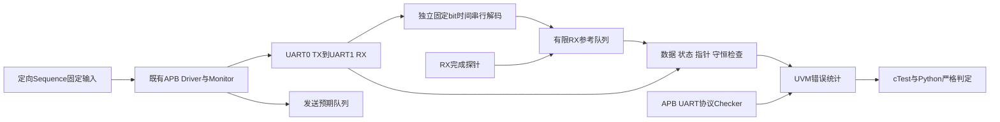

# RX FIFO Verification Stage 1 开发与验收报告

交付日期：2026-11-24（Asia/Shanghai）；开发从2026-11-23开始。仅交付冻结的第一批范围。

## 1. 验收结论

**TP01、TP02、TP03a、TP03b全部PASS，第一批达到验收标准。** 新收帧观察、有限FIFO模型、协议Checker失败传播均已实际编译和运行。最终套件11个验收条目全部符合预期：6个正向运行PASS，5个负向运行实际FAIL且Make退出码为2。另有5份专项VCD二次核验PASS、7项Python解析回归检查通过。

DUT未修改；原有 `baudrate_9600_complete` 重新运行仍为24次数据比较PASS。未实施TP04～TP07完整测试，未Commit、Push或创建PR。没有生成或宣称功能覆盖率百分比。

最终机器汇总：[stage1_acceptance.json](D:/Documents/projects/验证/UvmEnvUartApb/build/rx-stage1-20261123-232400/stage1_acceptance.json)；最终套件：[results.json](D:/Documents/projects/验证/UvmEnvUartApb/build/rx-stage1-20261123-232400/suite-1795449674214908704/results.json)；编译输入和二进制指纹：[build_manifest.json](D:/Documents/projects/验证/UvmEnvUartApb/build/rx-stage1-20261123-232400/build-04/build_manifest.json)。

## 2. 现场、版本与保全

真实仓库为 `D:\Documents\projects\验证\UvmEnvUartApb`。开发前分支为 `work/uart-apb-bringup`，HEAD为 `88f1a218b89b9a80ac15b30053e6edd121aab93a`，已跟踪文件无改动、已有11个未跟踪文件。本次在同一HEAD安全创建 `work/uart-rx-fifo-verification`，没有stash、清理或覆盖这些文件。

实际运行使用既有WSL Ubuntu环境：Verilator 5.052（v5.052）、Python 3.12.3、GCC 13.3.0；UVM SHA为 `78c06547a2a0a29b3dc9dcafae62b75b2ff61544`。工具来自原 `scripts/env_local.sh` 指定位置，只对执行进程source该脚本，未修改工具安装或主机配置。原始环境记录：[environment.json](D:/Documents/projects/验证/UvmEnvUartApb/build/rx-stage1-20261123-232400/suite-1795449674214908704/environment.json)。

全部构建和运行位于新的 `build/rx-stage1-20261123-232400/`。build-01～04各自独立；每次仿真进一步使用test/seed/时间戳/随机后缀目录，保存原始log、VCD、command.json和result.json。旧 `build/gen`、Day 0.5日志、VCD、原始FAIL及审计证据未重写。

开发前对3681份既有文件建立SHA256清单；交付核对结果：缺失0，原有11个未跟踪文件全部逐字节保持，DUT目录和所有历史build文件全部保持，只有下节列出的9份既有验证文件发生授权修改。详见 [修改前清单](D:/Documents/projects/验证/UvmEnvUartApb/build/rx-stage1-20261123-232400/preservation-before.json)、[保全核对](D:/Documents/projects/验证/UvmEnvUartApb/build/rx-stage1-20261123-232400/preservation-after.json)。

## 3. 修改与新增文件清单

### 3.1 修改9份既有文件

| 文件 | 职责 |
|---|---|
| [Makefile](D:/Documents/projects/验证/UvmEnvUartApb/Makefile) | BUILD_DIR 与 PLUSARGS，支持隔离构建和真实负向仿真 |
| [scripts/uartvip.py](D:/Documents/projects/验证/UvmEnvUartApb/scripts/uartvip.py) | test_base 选择、唯一run目录、构建/二进制指纹、严格全输出判定与RX完成契约、JSON证据 |
| [sim/testTop.sv](D:/Documents/projects/验证/UvmEnvUartApb/sim/testTop.sv) | 被动RX探针、config_db连接；独立APB/UART错误自测线，不驱动DUT输入 |
| [uvm_comp/ifDut.sv](D:/Documents/projects/验证/UvmEnvUartApb/uvm_comp/ifDut.sv) | ifRxFifoProbe，只读观察RX完成、WE/RE、指针和状态 |
| [uvm_comp/cScoreboard.sv](D:/Documents/projects/验证/UvmEnvUartApb/uvm_comp/cScoreboard.sv) | 三个analysis回调允许虚函数覆写；残留检查移至check_phase，保留旧正常数据比较 |
| [uvm_comp/cCommonSequence.sv](D:/Documents/projects/验证/UvmEnvUartApb/uvm_comp/cCommonSequence.sv) | 受检mask位使用严格未知值失败判断 |
| [checker/apb_protocol_checker.sv](D:/Documents/projects/验证/UvmEnvUartApb/checker/apb_protocol_checker.sv) | APB_ERROR进入UVM错误统计 |
| [checker/uart_protocol_checker.sv](D:/Documents/projects/验证/UvmEnvUartApb/checker/uart_protocol_checker.sv) | UART_ERROR进入UVM；初始化每帧START参考值修复误报；修正final格式 |
| [checker/uart_protocol_checker_top.sv](D:/Documents/projects/验证/UvmEnvUartApb/checker/uart_protocol_checker_top.sv) | uart1 checker PREADY连接本端pready_1 |

### 3.2 新增17份文件

| 文件 | 职责 |
|---|---|
| [uvm_comp/cRxFifoScoreboard.sv](D:/Documents/projects/验证/UvmEnvUartApb/uvm_comp/cRxFifoScoreboard.sv) | 有限FIFO模型、独立串行观察、接收提交配对、状态/数据/守恒检查 |
| [uvm_comp/cRxFifoSequence.sv](D:/Documents/projects/验证/UvmEnvUartApb/uvm_comp/cRxFifoSequence.sv) | 有界逐帧投放、保持/排空、空读、精确测试契约 |
| [uvm_comp/cRxFifoTest.sv](D:/Documents/projects/验证/UvmEnvUartApb/uvm_comp/cRxFifoTest.sv) | 仅专项测试factory override，正常测试保持原SB |
| [scripts/rx_fifo_stage1.py](D:/Documents/projects/验证/UvmEnvUartApb/scripts/rx_fifo_stage1.py) | 按既定顺序执行11个验收条目，明确区分负向实际FAIL与验收结果 |
| [scripts/rx_fifo_wave_audit.py](D:/Documents/projects/验证/UvmEnvUartApb/scripts/rx_fifo_wave_audit.py) | 以固定场景要求二次核验VCD边沿、准入、顺序及OV |
| [scripts/test_uartvip_results.py](D:/Documents/projects/验证/UvmEnvUartApb/scripts/test_uartvip_results.py) | 7项结果解析回归检查 |
| [docs/RX_FIFO_VERIFICATION_STAGE1.md](D:/Documents/projects/验证/UvmEnvUartApb/docs/RX_FIFO_VERIFICATION_STAGE1.md) | 本报告 |
| [pat/rx_fifo_observation_smoke/cVSequence.sv](D:/Documents/projects/验证/UvmEnvUartApb/pat/rx_fifo_observation_smoke/cVSequence.sv) | 专项pattern入口 |
| [pat/rx_fifo_observation_smoke/test_base.txt](D:/Documents/projects/验证/UvmEnvUartApb/pat/rx_fifo_observation_smoke/test_base.txt) | 声明cRxFifoTest基类 |
| [pat/rx_fifo_tp01/cVSequence.sv](D:/Documents/projects/验证/UvmEnvUartApb/pat/rx_fifo_tp01/cVSequence.sv) | 专项pattern入口 |
| [pat/rx_fifo_tp01/test_base.txt](D:/Documents/projects/验证/UvmEnvUartApb/pat/rx_fifo_tp01/test_base.txt) | 声明cRxFifoTest基类 |
| [pat/rx_fifo_tp02/cVSequence.sv](D:/Documents/projects/验证/UvmEnvUartApb/pat/rx_fifo_tp02/cVSequence.sv) | 专项pattern入口 |
| [pat/rx_fifo_tp02/test_base.txt](D:/Documents/projects/验证/UvmEnvUartApb/pat/rx_fifo_tp02/test_base.txt) | 声明cRxFifoTest基类 |
| [pat/rx_fifo_tp03a/cVSequence.sv](D:/Documents/projects/验证/UvmEnvUartApb/pat/rx_fifo_tp03a/cVSequence.sv) | 专项pattern入口 |
| [pat/rx_fifo_tp03a/test_base.txt](D:/Documents/projects/验证/UvmEnvUartApb/pat/rx_fifo_tp03a/test_base.txt) | 声明cRxFifoTest基类 |
| [pat/rx_fifo_tp03b/cVSequence.sv](D:/Documents/projects/验证/UvmEnvUartApb/pat/rx_fifo_tp03b/cVSequence.sv) | 专项pattern入口 |
| [pat/rx_fifo_tp03b/test_base.txt](D:/Documents/projects/验证/UvmEnvUartApb/pat/rx_fifo_tp03b/test_base.txt) | 声明cRxFifoTest基类 |

5个pattern均通过原有生成器注册；新增 `test_base.txt` 只选择专项基类。原17个pattern及SKIP文件均未修改；当前22个pattern目录中21个启用、1个原有SKIP。

## 4. 复用组件与新增职责

继续复用两个APB Agent、Sequencer、Driver、APB Monitor、Virtual Sequencer、Env连接、cTest watchdog和Makefile入口。未引入RAL、主动UART VIP或第三方依赖，未改DUT端口。



`cRxFifoScoreboard`是原SB的factory子类，仅在专项测试启用。旧测试继续用原SB；专项由完整替代检查负责合法空读与满时拒收，不创建旧无限发送队列，不会将第17帧合法丢弃报成UNFINISH。没有在sequence中删除预期队列、修改DUT指针或降级错误。

关键实现入口：[cRxFifoScoreboard.sv](D:/Documents/projects/验证/UvmEnvUartApb/uvm_comp/cRxFifoScoreboard.sv:120) 的 `decode_serial()`（120行）、`observe_receiver()`（148行）、`write_frmMonitorRX()`（60行）、`check_phase()`（191行）；[cRxFifoSequence.sv](D:/Documents/projects/验证/UvmEnvUartApb/uvm_comp/cRxFifoSequence.sv:10) 的 `wait_frames()`（10行）、`send_byte()`（22行）、`hold_fifo()`（40行）、`empty_read()`（62行）；[cRxFifoTest.sv](D:/Documents/projects/验证/UvmEnvUartApb/uvm_comp/cRxFifoTest.sv:7) 的factory override（7行）。

### 4.1 实际收帧和有界等待

从真实串行线下降沿记录START时间，按104800ns的固定bit时间采样START、8个LSB-first数据位与STOP中点，并等完整STOP时间结束后累计 `pin_completed`。数据预期来自源端APB发送输入，串行解码结果与之比较。对接收器提交事件另行观察，要求与已解码帧一一配对，提交处于独立START之后9～10个bit的窗口。

每发一字节，等待独立完整串行帧数及DUT完成数都达到精确目标、串行观察空闲，局部期限2ms，每10us查询；全局watchdog仍为100ms。缺帧、多帧、未完成帧、额外提交、无匹配数据、坏START/STOP均自动失败。随后才发下一帧，使TX FIFO不会先堆满。没有用NE=1、TX写次数或WE次数代替实际帧完成。

积累/保持窗口设置 `forbid_reads`；任何DATA读取报 `RX_ENV_EARLY_READ`。每个保持窗口持续200us并检查占用和事件数，之后才排空。

### 4.2 有限参考模型与采样

参考队列范围0～16；每次匹配提交按**参考队列**是否已有16项决定接受/拒收。数据预期不从DUT DATA、WE、full、指针、Raw或OV反向生成。DUT complete只用于提交时刻关联，其存在性同时受独立pin计数、时间窗和局部期限约束。

每次有效DATA读取比较沿前队首并出队；空读只检查高24位、实际RE=0、指针/占用/NE保持，不限定低8位。参考写/读指针由独立接纳和非空出队计数模32得到。每个目标pclk沿后2ns比较实际指针、empty、full、NE、默认RXT的RXF及OV，避开RTL的#1更新；APB数据继续采用原Monitor完成沿采样。

OV由独立满时拒收事件预测，DATA读请求清除；Raw/Masked读不修改模型。结束检查发送/pin开始/pin完成/提交数相等，完成=接受+拒收，接受=出队+剩余占用，所有队列和在途观察为空，精确计数和必达场景满足。连续模型错误达到20个时停止仿真，保留首个根因，避免错误风暴。

首批明确拒绝同拍提交+DATA读的越界场景，报 `RX_ENV_CONCURRENT`；没有悄悄把未实现的并发仲裁当作通过。

### 4.3 失败传播

APB_ERROR/UART_ERROR现在调用UVM错误接口，进入cTest统计；原SB残留检查从report_phase移到check_phase，保证最终判定前完成。Python额外检查完整输出中的协议错误tag、UVM实时错误/致命错误、severity汇总、模拟器退出码、结果行及超时，包括final回调后的错误。

专项还必须输出完整RX_CONTRACT/RX_FIFO_SUMMARY，精确满足帧、接受、拒收、出队、空读和hold数量；pin、数据比较数及容量边界命中也独立复核。构建manifest、当前源码/生成文件、WAVE/COV选项或二进制指纹不匹配时，run拒绝使用陈旧可执行文件。

错误ID区分 `RX_ENV_*` 配置/模型/未完成场景问题、`RX_DUT_*` 被检行为不符和 `APB_PROTOCOL/UART_PROTOCOL` 协议错误，并在日志保存来源与时间；最终根因仍结合波形判断。下面的UART误报案例已明确归为Checker问题。

## 5. Test Point与Testcase、输入和预期

固定配置：UART0/1时钟50/86ns，BR=130/75，双方EN=1、D9=0、EP=0、TXT/RXT=00、IE=0；只做UART0→UART1。初始化后不热改BR/D9/EP，不安排满时同拍收读。RXT=00使RXF恰好表示物理满；OV是独立保持标志；Masked为0；外部IRQ没有用作OV发生的判据。

| Test Point | Testcase | 固定输入与关键场景 | 自动预期 |
|---|---|---|---|
| 基础观察 | rx_fifo_observation_smoke | 0x69，接收后保持200us再读 | pin/提交/接受/出队各1，字节正确，最终空 |
| TP01 | rx_fifo_tp01 | 初始化3次空读；0x96接收保持/读出；排空后3次空读；0x3D接收保持/读出 | 空读6次不出队、不动rptr、NE=0；有效读2次；空低字节不约束 |
| TP02 | rx_fifo_tp02 | 第i个数据=(37i+11) mod256；按1/5/16/10/8分批，共40帧；每批全部收到再保持；部分批次读2项后暂停再读 | 完成/接受/出队/数据比较40；无拒收、无OV、无重复遗漏；5个保持窗口；跨完整5位指针回绕 |
| TP03a | rx_fifo_tp03a | D0～D15=13i+7；第17帧0xFA；前17帧完成前禁止DATA读 | 15未满；16满且OV0；17拒收且OV1；前16字节原序保留；首DATA读清OV；最后空 |
| TP03b | rx_fifo_tp03b | 同上；多次Raw/Masked读保持OV；读D0清OV；保留余15项时再收0xA5并保持，然后排空 | 总18帧、17接受、1拒收、17有效出队；OV读清后新帧可保存；旧D1～D15及新A5顺序正确 |

每个场景都有固定完成契约、局部期限、非零字节/状态比较、保持命中和结束守恒。TP03a/b先后完成17个真实串行帧，不是仅向TX写17次。

## 6. 实际运行结果和关键计数

以下全部来自最终build-04的原始运行及RX_FIFO_SUMMARY，seed均为1；6个正向运行的UVM_ERROR/FATAL和协议错误均为0，simulator与Make退出均为0。

| 测试 | 结果 | pin完整帧 | RX完成 | 接受 | 拒收 | 出队 | 空读 | 数据比较 | pin比较 | 状态读比较 | 状态周期 | 保持命中 | 最大占用 |
|---|---|---|---|---|---|---|---|---|---|---|---|---|---|
| observation_smoke | PASS | 1 | 1 | 1 | 0 | 1 | 0 | 1 | 1 | 9 | 18189 | 1 | 1 |
| TP01 | PASS | 2 | 2 | 2 | 0 | 2 | 6 | 2 | 2 | 30 | 33933 | 2 | 1 |
| TP02 | PASS | 40 | 40 | 40 | 0 | 40 | 0 | 40 | 40 | 48 | 551357 | 5 | 16 |
| TP03a | PASS | 17 | 17 | 16 | 1 | 16 | 0 | 16 | 17 | 30 | 232907 | 1 | 16 |
| TP03b | PASS | 18 | 18 | 17 | 1 | 17 | 0 | 17 | 18 | 33 | 248628 | 2 | 16 |

“状态周期”是沿后采样次数，每周期进行7项指针/状态比较；不是覆盖率。数据比较数指有效DATA队首比较；pin比较数包含满时被拒收的帧。TP03b的17接受/出队含OV清除后的恢复字节。

原 `baudrate_9600_complete`：实际PASS，24次数据比较、0失败、COMPLETE_CHECK pending_tx/pending_rx均0，UVM_ERROR/FATAL=0，sim_exit=0、make_exit=0，wall约60.5s。它沿用旧SB，没有伪造新模型的接收统计；本批没有扩大其原有协议覆盖结论。

### 6.1 VCD独立二次核验

5份专项VCD已用固定场景要求重新检查，全部PASS，实测WE/RE/提交/空读次数与上表一致；DATA读值与固定预期数组逐项一致。TP02实际读写指针各完成1次31→0回绕，最大实际占用16。

TP03a/b均实际命中：第15帧提交前占用14、WE=1；第16帧前占用15、WE=1；第17帧前占用16、full=1、WE=0，此前有效出队0且该沿无DATA读。后续状态读看到占用16且Raw=3（满、OV0），再看到Raw=7（满、OV1），多次Raw/Masked读取后OV保持；首DATA读后占用15且Raw=1（OV清）。拒收字节0xFA未覆盖原有16项；TP03b最后正确读出恢复字节0xA5。

二次核验是实际波形统计加固定预期比较，不是另一份仿真，也不替代在线模型。具体时间戳、字节数组、准入节点及VCD SHA256保存在每份 `wave-audit.json`。

## 7. 最小负向自测的真实结果

| 自测 | 预期错误ID | 实际结果 | UVM E | UVM F | 协议错误消息 | sim退出 | Make退出 | 自测验收 | 证据 |
|---|---|---|---|---|---|---|---|---|---|
| negative_protocol | [APB_PROTOCOL] | FAIL | 3 | 0 | 3 | 0 | 2 | PASS | [日志](D:/Documents/projects/验证/UvmEnvUartApb/build/rx-stage1-20261123-232400/build-04/runs/test_rx_fifo_observation_smoke.s1.1795449677538744015.b8e49f/simulator.log) |
| negative_uart_glitch | [UART_PROTOCOL] | FAIL | 1 | 0 | 2 | 0 | 2 | PASS | [日志](D:/Documents/projects/验证/UvmEnvUartApb/build/rx-stage1-20261123-232400/build-04/runs/test_rx_fifo_observation_smoke.s1.1795449680242068441.16bd7e/simulator.log) |
| negative_expectation | [READ FAIL] | FAIL | 1 | 0 | 0 | 0 | 2 | PASS | [日志](D:/Documents/projects/验证/UvmEnvUartApb/build/rx-stage1-20261123-232400/build-04/runs/test_rx_fifo_observation_smoke.s1.1795449682933398453.881b68/simulator.log) |
| negative_global_timeout | [CTEST TIMEOUT] | FAIL | 3 | 0 | 0 | 0 | 2 | PASS | [日志](D:/Documents/projects/验证/UvmEnvUartApb/build/rx-stage1-20261123-232400/build-04/runs/test_rx_fifo_observation_smoke.s1.1795449685577938690.161887/simulator.log) |
| negative_missing_frame | [RX_DUT_FRAME_TIMEOUT] | FAIL | 0 | 1 | 0 | 0 | 2 | PASS | [日志](D:/Documents/projects/验证/UvmEnvUartApb/build/rx-stage1-20261123-232400/build-04/runs/test_rx_fifo_observation_smoke.s1.1795449686462168491.5bfdf5/simulator.log) |

5项“验收PASS”表示**故意制造的失败被正确识别**；它们的实际测试结果仍是FAIL，没有混入功能测试PASS数量。所有非预期错误都会使负向验收失败。

APB自测对独立checker实例制造PSEL/PENABLE非法SETUP；UART自测在线路START位内注入200ns毛刺，两者均不连接DUT输入。错误预期自测固定要求读0x68而实际发送/读到0x69。全局超时设1000ns；局部缺帧自测不发送数据却要求1帧，约2ms后RX_DUT_FRAME_TIMEOUT。

这些仿真器进程本身的退出码均为0（UVM通过finish结束），Python依错误统计判FAIL并返回1，Make返回2。因此验收不依赖sim_exit或TEST PASSED单一文本。UART毛刺的UVM汇总为1个错误，final又重复报告一次，协议错误消息共2条；完整输出扫描会捕获final消息。

另有7项结果解析回归检查，验证PASS后的错误、迟发fatal、非零退出、缺severity/结果、缺完成契约、超时，以及零比较/缺帧/缺hold计数均不能误PASS；实际进程退出0。证据：[parser-selftest-result.json](D:/Documents/projects/验证/UvmEnvUartApb/build/rx-stage1-20261123-232400/parser-selftest-result.json)。

## 8. 遇到的问题与修复记录

| 问题 | 实际证据与处理 | 交付状态 |
|---|---|---|
| build-01 WSL中断 | C++编译未完成，没有可执行验收结果；原因未确定，保留日志 | 未算编译PASS |
| build-02单编译单元过大且耗时长 | 主动终止，signal15日志保留；改用--output-groups 8拆分UVM C++编译 | build-03和04均真实编译成功 |
| TP01首次被旧UART Checker误报 | build-03的FIFO模型错误0、2帧/2入/2出/6空读均正确；第二帧START后约99ns却报expected1/actual0 | 保留原FAIL及VCD；不改成历史PASS |
| Checker沿用上一帧位值 | 每个frame_start重新采当前START参考值，并在reset初始化；后续bit检查继续执行 | build-04全套正向无误报；START内毛刺仍真实报UART_PROTOCOL并使Make失败 |
| $display错误不影响验收 | 协议错误改入UVM；脚本扫完整输出，残留检查提前；精确计数gate | 5类真实负向验证生效 |
| uart1 Checker PREADY接错端 | 改为pready_1；两端当前恒1，未改变DUT行为 | 已修正验证接线 |

首轮诊断FAIL：[TP01首轮FAIL日志](D:/Documents/projects/验证/UvmEnvUartApb/build/rx-stage1-20261123-232400/build-03/runs/test_rx_fifo_tp01.s1.1795449053620666742.856ee6/simulator.log)；其FIFO波形部分核对：[首轮FIFO部分核对](D:/Documents/projects/验证/UvmEnvUartApb/build/rx-stage1-20261123-232400/build-03/runs/test_rx_fifo_tp01.s1.1795449053620666742.856ee6/wave-audit.json)。最终成功构建日志：[最终编译日志](D:/Documents/projects/验证/UvmEnvUartApb/build/rx-stage1-20261123-232400/build-04/logs/build_verilator.log)（实际约503.4s，exit0）；构建尝试记录与各次console均位于证据根目录。首轮suite失败和最终suite成功分别独立保留。

本批未发现需要修改DUT才能通过冻结测试的设计缺陷。F2中满时同拍读/收、disable与OV、校验极性等设计疑点未被本批验收覆盖，也未擅自修复或改规格。

## 9. 日志、波形、结果和命令索引

| 条目 | 日志 | 波形 | 仿真命令 | 结果 | 专项波形判据 |
|---|---|---|---|---|---|
| observation_smoke | [原始日志](D:/Documents/projects/验证/UvmEnvUartApb/build/rx-stage1-20261123-232400/build-04/runs/test_rx_fifo_observation_smoke.s1.1795449674855716691.0282aa/simulator.log) | [VCD](D:/Documents/projects/验证/UvmEnvUartApb/build/rx-stage1-20261123-232400/build-04/runs/test_rx_fifo_observation_smoke.s1.1795449674855716691.0282aa/wave.vcd) | [命令](D:/Documents/projects/验证/UvmEnvUartApb/build/rx-stage1-20261123-232400/build-04/runs/test_rx_fifo_observation_smoke.s1.1795449674855716691.0282aa/command.json) | [结果](D:/Documents/projects/验证/UvmEnvUartApb/build/rx-stage1-20261123-232400/build-04/runs/test_rx_fifo_observation_smoke.s1.1795449674855716691.0282aa/result.json) | [波形核验](D:/Documents/projects/验证/UvmEnvUartApb/build/rx-stage1-20261123-232400/build-04/runs/test_rx_fifo_observation_smoke.s1.1795449674855716691.0282aa/wave-audit.json) |
| negative_protocol | [原始日志](D:/Documents/projects/验证/UvmEnvUartApb/build/rx-stage1-20261123-232400/build-04/runs/test_rx_fifo_observation_smoke.s1.1795449677538744015.b8e49f/simulator.log) | [VCD](D:/Documents/projects/验证/UvmEnvUartApb/build/rx-stage1-20261123-232400/build-04/runs/test_rx_fifo_observation_smoke.s1.1795449677538744015.b8e49f/wave.vcd) | [命令](D:/Documents/projects/验证/UvmEnvUartApb/build/rx-stage1-20261123-232400/build-04/runs/test_rx_fifo_observation_smoke.s1.1795449677538744015.b8e49f/command.json) | [结果](D:/Documents/projects/验证/UvmEnvUartApb/build/rx-stage1-20261123-232400/build-04/runs/test_rx_fifo_observation_smoke.s1.1795449677538744015.b8e49f/result.json) | 负向/旧SB，无专项波形判据 |
| negative_uart_glitch | [原始日志](D:/Documents/projects/验证/UvmEnvUartApb/build/rx-stage1-20261123-232400/build-04/runs/test_rx_fifo_observation_smoke.s1.1795449680242068441.16bd7e/simulator.log) | [VCD](D:/Documents/projects/验证/UvmEnvUartApb/build/rx-stage1-20261123-232400/build-04/runs/test_rx_fifo_observation_smoke.s1.1795449680242068441.16bd7e/wave.vcd) | [命令](D:/Documents/projects/验证/UvmEnvUartApb/build/rx-stage1-20261123-232400/build-04/runs/test_rx_fifo_observation_smoke.s1.1795449680242068441.16bd7e/command.json) | [结果](D:/Documents/projects/验证/UvmEnvUartApb/build/rx-stage1-20261123-232400/build-04/runs/test_rx_fifo_observation_smoke.s1.1795449680242068441.16bd7e/result.json) | 负向/旧SB，无专项波形判据 |
| negative_expectation | [原始日志](D:/Documents/projects/验证/UvmEnvUartApb/build/rx-stage1-20261123-232400/build-04/runs/test_rx_fifo_observation_smoke.s1.1795449682933398453.881b68/simulator.log) | [VCD](D:/Documents/projects/验证/UvmEnvUartApb/build/rx-stage1-20261123-232400/build-04/runs/test_rx_fifo_observation_smoke.s1.1795449682933398453.881b68/wave.vcd) | [命令](D:/Documents/projects/验证/UvmEnvUartApb/build/rx-stage1-20261123-232400/build-04/runs/test_rx_fifo_observation_smoke.s1.1795449682933398453.881b68/command.json) | [结果](D:/Documents/projects/验证/UvmEnvUartApb/build/rx-stage1-20261123-232400/build-04/runs/test_rx_fifo_observation_smoke.s1.1795449682933398453.881b68/result.json) | 负向/旧SB，无专项波形判据 |
| negative_global_timeout | [原始日志](D:/Documents/projects/验证/UvmEnvUartApb/build/rx-stage1-20261123-232400/build-04/runs/test_rx_fifo_observation_smoke.s1.1795449685577938690.161887/simulator.log) | [VCD](D:/Documents/projects/验证/UvmEnvUartApb/build/rx-stage1-20261123-232400/build-04/runs/test_rx_fifo_observation_smoke.s1.1795449685577938690.161887/wave.vcd) | [命令](D:/Documents/projects/验证/UvmEnvUartApb/build/rx-stage1-20261123-232400/build-04/runs/test_rx_fifo_observation_smoke.s1.1795449685577938690.161887/command.json) | [结果](D:/Documents/projects/验证/UvmEnvUartApb/build/rx-stage1-20261123-232400/build-04/runs/test_rx_fifo_observation_smoke.s1.1795449685577938690.161887/result.json) | 负向/旧SB，无专项波形判据 |
| negative_missing_frame | [原始日志](D:/Documents/projects/验证/UvmEnvUartApb/build/rx-stage1-20261123-232400/build-04/runs/test_rx_fifo_observation_smoke.s1.1795449686462168491.5bfdf5/simulator.log) | [VCD](D:/Documents/projects/验证/UvmEnvUartApb/build/rx-stage1-20261123-232400/build-04/runs/test_rx_fifo_observation_smoke.s1.1795449686462168491.5bfdf5/wave.vcd) | [命令](D:/Documents/projects/验证/UvmEnvUartApb/build/rx-stage1-20261123-232400/build-04/runs/test_rx_fifo_observation_smoke.s1.1795449686462168491.5bfdf5/command.json) | [结果](D:/Documents/projects/验证/UvmEnvUartApb/build/rx-stage1-20261123-232400/build-04/runs/test_rx_fifo_observation_smoke.s1.1795449686462168491.5bfdf5/result.json) | 负向/旧SB，无专项波形判据 |
| TP01 | [原始日志](D:/Documents/projects/验证/UvmEnvUartApb/build/rx-stage1-20261123-232400/build-04/runs/test_rx_fifo_tp01.s1.1795449689530524710.d58c7c/simulator.log) | [VCD](D:/Documents/projects/验证/UvmEnvUartApb/build/rx-stage1-20261123-232400/build-04/runs/test_rx_fifo_tp01.s1.1795449689530524710.d58c7c/wave.vcd) | [命令](D:/Documents/projects/验证/UvmEnvUartApb/build/rx-stage1-20261123-232400/build-04/runs/test_rx_fifo_tp01.s1.1795449689530524710.d58c7c/command.json) | [结果](D:/Documents/projects/验证/UvmEnvUartApb/build/rx-stage1-20261123-232400/build-04/runs/test_rx_fifo_tp01.s1.1795449689530524710.d58c7c/result.json) | [波形核验](D:/Documents/projects/验证/UvmEnvUartApb/build/rx-stage1-20261123-232400/build-04/runs/test_rx_fifo_tp01.s1.1795449689530524710.d58c7c/wave-audit.json) |
| TP02 | [原始日志](D:/Documents/projects/验证/UvmEnvUartApb/build/rx-stage1-20261123-232400/build-04/runs/test_rx_fifo_tp02.s1.1795449693680569983.b9891b/simulator.log) | [VCD](D:/Documents/projects/验证/UvmEnvUartApb/build/rx-stage1-20261123-232400/build-04/runs/test_rx_fifo_tp02.s1.1795449693680569983.b9891b/wave.vcd) | [命令](D:/Documents/projects/验证/UvmEnvUartApb/build/rx-stage1-20261123-232400/build-04/runs/test_rx_fifo_tp02.s1.1795449693680569983.b9891b/command.json) | [结果](D:/Documents/projects/验证/UvmEnvUartApb/build/rx-stage1-20261123-232400/build-04/runs/test_rx_fifo_tp02.s1.1795449693680569983.b9891b/result.json) | [波形核验](D:/Documents/projects/验证/UvmEnvUartApb/build/rx-stage1-20261123-232400/build-04/runs/test_rx_fifo_tp02.s1.1795449693680569983.b9891b/wave-audit.json) |
| TP03a | [原始日志](D:/Documents/projects/验证/UvmEnvUartApb/build/rx-stage1-20261123-232400/build-04/runs/test_rx_fifo_tp03a.s1.1795449748930831407.aa4846/simulator.log) | [VCD](D:/Documents/projects/验证/UvmEnvUartApb/build/rx-stage1-20261123-232400/build-04/runs/test_rx_fifo_tp03a.s1.1795449748930831407.aa4846/wave.vcd) | [命令](D:/Documents/projects/验证/UvmEnvUartApb/build/rx-stage1-20261123-232400/build-04/runs/test_rx_fifo_tp03a.s1.1795449748930831407.aa4846/command.json) | [结果](D:/Documents/projects/验证/UvmEnvUartApb/build/rx-stage1-20261123-232400/build-04/runs/test_rx_fifo_tp03a.s1.1795449748930831407.aa4846/result.json) | [波形核验](D:/Documents/projects/验证/UvmEnvUartApb/build/rx-stage1-20261123-232400/build-04/runs/test_rx_fifo_tp03a.s1.1795449748930831407.aa4846/wave-audit.json) |
| TP03b | [原始日志](D:/Documents/projects/验证/UvmEnvUartApb/build/rx-stage1-20261123-232400/build-04/runs/test_rx_fifo_tp03b.s1.1795449771238037565.821237/simulator.log) | [VCD](D:/Documents/projects/验证/UvmEnvUartApb/build/rx-stage1-20261123-232400/build-04/runs/test_rx_fifo_tp03b.s1.1795449771238037565.821237/wave.vcd) | [命令](D:/Documents/projects/验证/UvmEnvUartApb/build/rx-stage1-20261123-232400/build-04/runs/test_rx_fifo_tp03b.s1.1795449771238037565.821237/command.json) | [结果](D:/Documents/projects/验证/UvmEnvUartApb/build/rx-stage1-20261123-232400/build-04/runs/test_rx_fifo_tp03b.s1.1795449771238037565.821237/result.json) | [波形核验](D:/Documents/projects/验证/UvmEnvUartApb/build/rx-stage1-20261123-232400/build-04/runs/test_rx_fifo_tp03b.s1.1795449771238037565.821237/wave-audit.json) |
| legacy_complete | [原始日志](D:/Documents/projects/验证/UvmEnvUartApb/build/rx-stage1-20261123-232400/build-04/runs/test_baudrate_9600_complete.s1.1795449795221309908.e4874a/simulator.log) | [VCD](D:/Documents/projects/验证/UvmEnvUartApb/build/rx-stage1-20261123-232400/build-04/runs/test_baudrate_9600_complete.s1.1795449795221309908.e4874a/wave.vcd) | [命令](D:/Documents/projects/验证/UvmEnvUartApb/build/rx-stage1-20261123-232400/build-04/runs/test_baudrate_9600_complete.s1.1795449795221309908.e4874a/command.json) | [结果](D:/Documents/projects/验证/UvmEnvUartApb/build/rx-stage1-20261123-232400/build-04/runs/test_baudrate_9600_complete.s1.1795449795221309908.e4874a/result.json) | 负向/旧SB，无专项波形判据 |

每行command.json记录实际仿真命令、cwd、seed和build manifest；suite目录的同名 `.command.json` 记录Make命令、真实退出码与wall时间；environment.json、results.json、suite_result.json形成汇总。配置字段明确标为测试契约，并注明是否达到初始化完成checkpoint，1000ns超时运行未假定配置已完成。

## 10. 复现方式

在项目根目录的WSL Bash中，复用既有环境脚本。以下新root必须未被使用：

```bash
source scripts/env_local.sh
python3 -B scripts/rx_fifo_stage1.py --root build/rx-stage1-new-run
```

脚本拒绝在已有build目录上重新构建；仿真run目录始终唯一。它按观察→负向→TP01→TP02→TP03a/b→旧正常测试的顺序执行，前置失败即停止。避免使用历史local-day0/day05封装进行新验收，它们的复制路径绑定旧固定日志名；这些原文件为保全对象，未改写。新结果应以本报告索引和每次run的JSON为准。

本次实际完整命令：

```bash
source scripts/env_local.sh
make build BUILD_DIR=build/rx-stage1-20261123-232400/build-04 WAVE=1 JOBS=2
python3 -B scripts/rx_fifo_stage1.py --root build/rx-stage1-20261123-232400 --build-name build-04 --skip-build
```

单项调试可用同一BUILD_DIR下的 `make run TEST=rx_fifo_tp03a WAVE=1 SEED=1`；前面须传入上述BUILD_DIR。运行只在源文件/生成库/选项/二进制指纹匹配时允许。负向例子：同一命令加入 `TEST=rx_fifo_observation_smoke PLUSARGS=UART_CHECKER_SELFTEST`，预期Make返回2。

VCD二次核验独立执行：

```bash
python3 -B scripts/rx_fifo_wave_audit.py <本次run目录>/wave.vcd tp03a
python3 -B scripts/test_uartvip_results.py
```

wave审计以创建新文件方式保存，已有wave-audit.json不会被覆盖。本批没有运行COV=1或合并coverage数据库；命中计数不等同功能覆盖率。Questa、完整四态X/Z和其他平台未在本批执行，运行证据仅适用于上述本地Verilator版本。

## 11. 未完成项与第二批建议

首批冻结范围没有BLOCKED或未完成项。未开展的下一批内容包括：RXT四档/动态阈值、达到低水位继续填满的参数化套件、IE与Raw/Masked门控、注册IRQ周期和多源保持、同拍收读、disable/reset恢复、PE/FE队首元数据、完整Coverage模型。

下一批应复用本次被动probe、独立pin事件、有限队列、公共有界投放/保持原语及失败传播；扩展RXT/IE参考状态和IRQ采样契约，再增加TP04～TP07。当前Stage1模型有意校验静态EN/无校验/默认RXT/IE0，不能直接将其当作通用UART参考模型。满时同拍收读和校验定义等疑点仍需规格责任人确认。当前只是固定seed/方向/时钟组合的定向验收，没有宣称UART IP全面验证完成。

## 12. Git与最终交付状态

分支为 `work/uart-rx-fifo-verification`，HEAD仍是开发前SHA；9份已跟踪验证文件修改、17份本批新增文件，全部保留为未提交差异。加上原11份未跟踪文件，当前未跟踪总数28。暂存区未变化，没有Commit、Push或PR。

原有未跟踪文件逐项为：docs/day0.5-test-diagnosis.md、docs/local-bringup-report.md、docs/uart-apb.gtkw、pat/baudrate_9600_complete/cVSequence.sv、scripts/day05-evidence.py、scripts/env_local.sh、scripts/local-day0.sh、scripts/local-day05.sh、scripts/local-evidence.py、scripts/local.sh、scripts/view-wave.sh；均经初始SHA256核对保持不变。原始baudrate_9600历史FAIL、Day 0.5全部证据和旧生成结果保持原样。

编译输入/二进制身份检查、七项解析检查、最终11条目验收、五份专项波形核验与既有文件保全记录均已完成。本阶段到此停止，不进入TP04～TP07。
